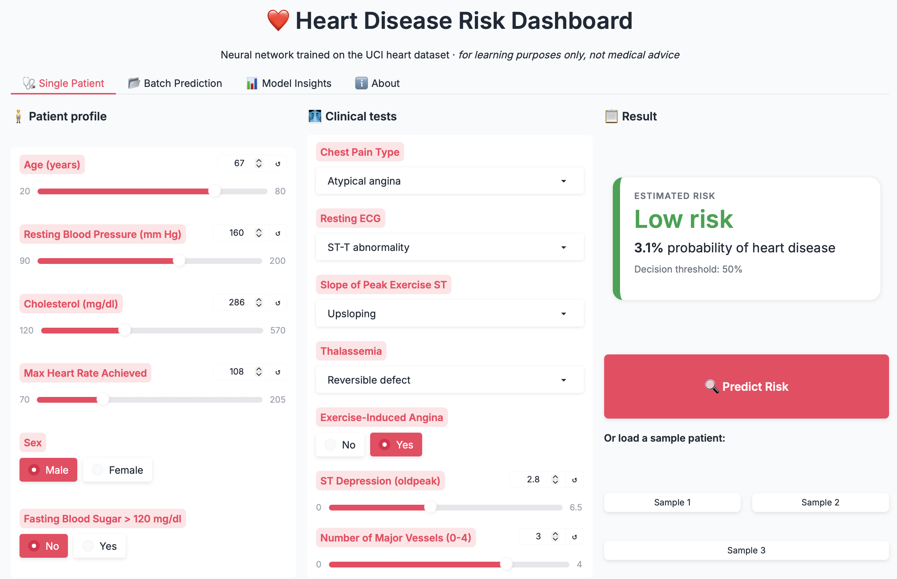
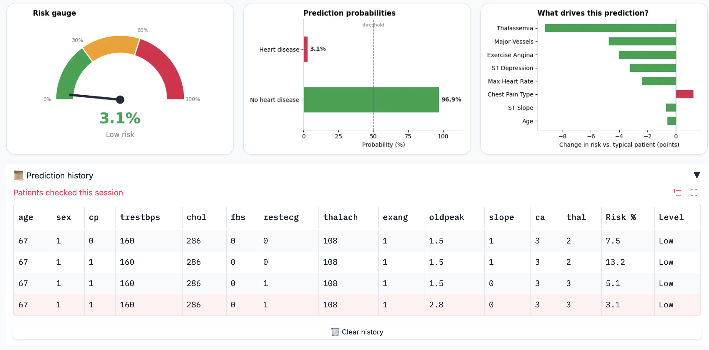

# ❤️ CardioRisk-NN

**Heart disease risk prediction with a neural network and an interactive Gradio dashboard.**


[](https://colab.research.google.com/github/hajigul/heart-disease-risk-predictor-heartguard-ai/blob/main/heart_disease_prediction.ipynb)

> ⚠️ **Disclaimer:** This project is for educational purposes only. It is not a medical device and must not be used for diagnosis or clinical decisions.

---

## Dashboard Preview

### Patient input and result

Enter a patient's profile and clinical test results, then click **Predict Risk** (or load one of the three sample patients). The result card shows the estimated probability and the risk level.

<p align="center">
  
</p>

### Risk gauge, probabilities, and key drivers

Each prediction comes with a risk gauge, a probability chart with the 50% decision threshold, and a **"What drives this prediction?"** chart. The key drivers chart shows how much each input raises (red) or lowers (green) the risk compared with a typical patient. Every prediction is also logged in a session history table.

<p align="center">
  
</p>

---

## Overview

CardioRisk-NN trains a small feed-forward neural network to estimate the probability that a patient has heart disease from 13 clinical attributes. The trained model is wrapped in a multi-tab web dashboard so results can be explored without writing code.

## Features

- **End-to-end pipeline:** loading, one-hot encoding, stratified split, scaling, training, and evaluation
- **Regularized neural network:** dropout layers and early stopping against overfitting
- **Interactive dashboard (Gradio):**
  - **Single Patient:** input form, colour-coded risk gauge, probability bars, and a key drivers chart
  - **Batch Prediction:** upload a CSV, get predictions for every row, and download the results
  - **Model Insights:** test accuracy, precision, recall, F1-score, training curves, and confusion matrix
  - **About:** a description of each input feature
- **Session history:** keeps a log of the patients checked in the current session

## Dataset

The [UCI Heart Disease dataset](https://archive.ics.uci.edu/dataset/45/heart+disease) (Cleveland subset): **303 patients, 13 features, 1 binary target** (`1` = heart disease, `0` = no disease).

| Type | Features |
|---|---|
| Numeric | `age`, `trestbps`, `chol`, `thalach`, `oldpeak` |
| Categorical | `sex`, `cp`, `fbs`, `restecg`, `exang`, `slope`, `ca`, `thal` |

The dataset file (`heart.csv`) is not included in this repository. Download it from UCI or Kaggle and place it where the notebook's `path` variable points.

## Methodology

1. **Preprocessing:** categorical columns are one-hot encoded (13 → 30 input features), and numeric features are standardized with `StandardScaler`. The scaler is fit on the training set only, which avoids data leakage.
2. **Split:** 80% train / 20% test, stratified, `random_state=42`.
3. **Model:**

   | Layer | Output | Notes |
   |---|---|---|
   | Input | 30 | One-hot + scaled features |
   | Dense + ReLU | 32 | Dropout 0.3 |
   | Dense + ReLU | 16 | Dropout 0.3 |
   | Dense + Sigmoid | 1 | Probability of heart disease |

   1,537 trainable parameters in total.
4. **Training:** Adam optimizer, binary cross-entropy loss, batch size 16, up to 200 epochs with early stopping (patience 15, best weights restored). In the reported run, training stopped at epoch 62.

## Results

Evaluated on the held-out test set (61 patients):

| Metric | Value |
|---|---|
| **Accuracy** | **81.97%** |
| Precision (disease) | 0.81 |
| Recall (disease) | 0.88 |
| F1-score (disease) | 0.84 |

**Confusion matrix**

|  | Predicted: No disease | Predicted: Disease |
|---|---|---|
| **Actual: No disease** | 21 | 7 |
| **Actual: Disease** | 4 | 29 |

> The test set is small (61 samples), so these figures carry considerable uncertainty. Cross-validation would give a more reliable estimate.

## Getting Started

### Option 1: Google Colab (recommended)

1. Click the **Open in Colab** badge at the top.
2. Upload `heart.csv` to your Google Drive or Colab session and update the `path` variable in the data-loading cell.
3. Run all cells in order. The last cell launches the dashboard and prints a public link.

### Option 2: Run locally

```bash
git clone https://github.com/hajigul/heart-disease-risk-predictor-heartguard-ai.git
cd heart-disease-risk-predictor-heartguard-ai
python -m venv venv
source venv/bin/activate        # Windows: venv\Scripts\activate
pip install numpy pandas matplotlib scikit-learn tensorflow gradio jupyter
jupyter notebook heart_disease_prediction.ipynb
```

When running locally, remove the Google Drive mount cell and set `path` to the location of your `heart.csv`.

## Project Structure

```
heart-disease-risk-predictor-heartguard-ai/
├── heart_disease_prediction.ipynb   # Training, evaluation, and dashboard
├── p1.png                           # Dashboard screenshot: inputs and result
├── p2.png                           # Dashboard screenshot: charts and history
└── README.md
```

## Batch Prediction Format

Upload a CSV with these columns (the `target` column is optional, and if present the dashboard reports accuracy):

`age, sex, cp, trestbps, chol, fbs, restecg, thalach, exang, oldpeak, slope, ca, thal`

## Limitations and Future Work

- Small dataset (303 patients) from a single source, so the model may not generalize to other populations.
- Only a single train/test split is reported; k-fold cross-validation would be more robust.
- Possible extensions: compare with Logistic Regression, Random Forest, and XGBoost baselines; add SHAP-based explanations; calibrate probabilities; deploy on Hugging Face Spaces.

## Tech Stack

Python · TensorFlow/Keras · scikit-learn · pandas · NumPy · Matplotlib · Gradio

## Acknowledgements

- Dataset: Janosi, A., Steinbrunn, W., Pfisterer, M., Detrano, R. *Heart Disease*. UCI Machine Learning Repository.

## Author

**Haji Gul**
[GitHub](https://github.com/hajigul) · hajigul1993@gmail.com
